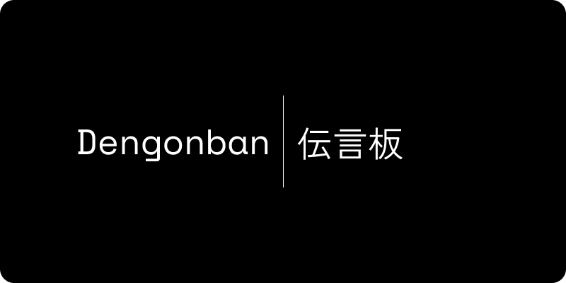
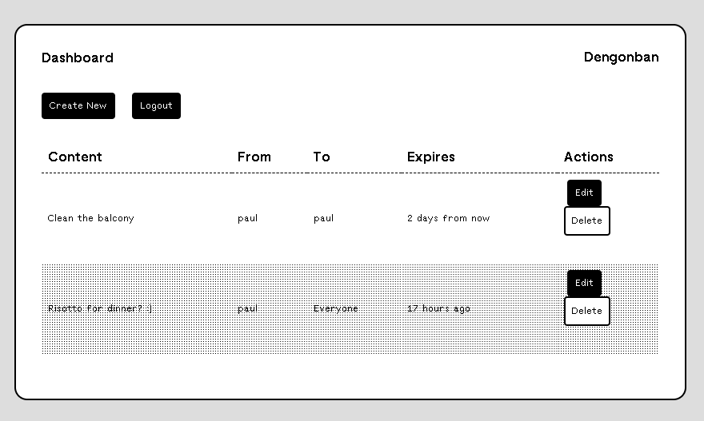

---
tags:
  - showcase
modified_timestamp: 2025-06-15T18:39:15+03:00
created_timestamp: 2025-06-01T13:38:45+03:00
title: Dengonban
type: project
date: 2025-06-01
description: Lightweight notice board for TRMNL.
---

[Source](https://sr.ht/~hxii/dengonban/) | [Issues and Feature Requests](https://todo.sr.ht/~hxii/dengonban)

## What is this?

Dengonban (伝言板, "Message Board" in Japanese) is a [TRMNL](https://usetrmnl.com) plugin to provide a notice board functionality to the device.

## Why?

Having received my TRMNL device, I figured a nice addition would be to create a plugin that will allow me and my wife to leave async messages for each other.
Think of this like a announcement or a reminder.
And while you can definitely just send webhooks and let TRMNL do the rest with the data, I figured having the ability to manage these messages could also be nice.
So I've decided to create my first docker-ized app.

## Installation

### Local Build
The easiest way to get this to work is as follows:
1. Clone the repository: `git clone https://git.sr.ht/~hxii/dengonban`
2. `cd` into the cloned repository
3. Create a token for TRMNL: `./create-token.py -t`
4. Create a token for yourself: `./create-token -u <your-name>`
5. Build the image: `make build`
6. Run the image: `DASHBOARD_ENABLED=1 make run`
### Docker Compose
1. Clone the repository: `git clone https://git.sr.ht/~hxii/dengonban`
2. `cd` into the cloned repository
3. Create a token for TRMNL: `./create-token.py -t`
4. Create a token for yourself: `./create-token -u <your-name>`
5. Edit `docker-compose.yml` to include the `DASHBOARD_ENABLED` environment variable if you want the dashboard enabled
6. Run compose: `docker-compose up`
### Portainer
1. Clone the repository: `git clone https://git.sr.ht/~hxii/dengonban`
2. cd` into the cloned repository
3. Create a token for TRMNL: `./create-token.py -t`
4. Create a token for yourself: `./create-token -u <your-name>`
5. Create a new container in Portainer
6. Set "Image" to `hxii0/dengonban:latest`
7. Map the container's `8000` port to whichever port of your host that you want
8. Create a volume mount for the container's `/app/data` directory pointing to wherever you cloned the repository
9. Add the `DASHBOARD_ENABLED` environment variable with the value `1` to enable dashboard
10. Run it
## Features

- FastAPI CRUD endpoints for messages
- Simple dashboard
- Different message types (configured in `data/message-types.json`)
- Message expiration time
- Multiple people