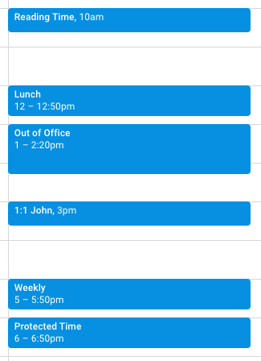
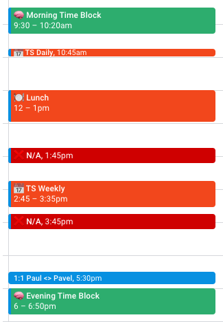

I use multiple calendars to separate contexts as well as todo lists to get stuff done, and since I use [Fantastical](https://www.fastmail.com/) to consolidate all of these sources to a "single window" into my schedule (but also each source separately), not categorizing or writing meeting and block titles properly causes all of them to appear similar, which in turn requires more mental effort as I'd have to look and read the titles to understand the task's importance once I need to do anything with the schedule.

For the record, I consolidate my personal FastMail calendars (personal and family calendars), work calendars (personal, manager, team mates and group calendars) and [Todoist](https://todoist.com/) tasks (personal, work and home tasks).

I devised a simple set of rules, or guidelines to visually encode my schedule so that it is more easily understood in a quick glance without having to go into details.

!!! important Important
	1. The rules/guidelines are ordered by visual importance.
	2. The guidelines are not final and are subject to change.
	3. Color (scale from red to green) and emoji (person, two people, brain) usage are language-less and thus should be universally understood

## Rules
- **Color coded** meetings following the concept of [MoSCoW Method](https://en.wikipedia.org/wiki/MoSCoW_method). Since the whole meeting "block" is made of this color, it's the first visually distinct and thusly most important thing.
	- **Red**: must happen and cannot move, e.g. `❌ N/A` when I have to pick up the kid.
	- **Orange**: should happen, but can move if required. Usually ordinary meetings, periodic meetings.
	- **Yellow**: would happen, but can move if required. Generally less of a priority. Temporary or non-mandatory meetings.
	- **Green**: could happen, but can be moved if required. Signifies time blocks, e.g. "Morning Time Block".
- **Emoji prefix** which represents the meeting "type" or "category" and helps when quickly scanning through the schedule without reading the entire title.
  **Important:** Visually striking emoji such as ⚠️, ❌ or ❗️ should be used sparsely, as their intrinsic visual value is higher than more "neutral" emojis.
	- 👤 For personal (one on one) meetings.
	- 👥 For group meetings.
	- 📆 For recurring (daily, weekly, monthly) meetings.
	- 🧠 For time blocks (protection).
	- 🍽️  For meals.
- **Meeting titles** should follow some basic rules.
	- **Meeting types** before additional information, e.g. `Daily - Tech Support`.
	- **Periodic meetings** are denoted as such, e.g `Weekly - Paul & Person` in the title.
	- **Personal meetings** are formatted as `<Scheduler> & <Partner>`, e.g. `Paul & Person`.
## Before

## After

